# Plugins de Jellyfin

Nueve plugins pequeños que añaden cosas útiles a tu servidor Jellyfin: un diario de cine, un blog, reseñas, una lista de pendientes, avisos a los usuarios y algunos extras. Son independientes: instala solo los que quieras.

No modifican ningún fichero de Jellyfin: se instalan como plugins normales desde el catálogo. Cuando sale una versión nueva de Jellyfin puede hacer falta actualizar el plugin; los de este repositorio se comprueban contra las versiones nuevas (12.3 y 12.4 ya compilan).

## Qué hace cada uno

| Plugin | Para qué sirve |
|---|---|
| **Diary** (Diario) | Apunta solo las películas que ves, con fecha y nota, y te hace un resumen de tu año. |
| **Blog** | Un blog de cine compartido: borradores, entradas privadas y las carátulas de las películas que mencionas. |
| **Watchlist** (Mi lista) | Tu lista de «para ver», en una pantalla propia. |
| **Reviews** | Reseñas de los usuarios, con estrellas, en cada película. |
| **AdminMessages** | Avisos del administrador a los usuarios, con una campana. |
| **Recomendación Semanal** | Un aviso una vez por semana con una recomendación. |
| **JellyAsk** | Un botón «Pedir película» que deja la petición en el registro de actividad. |
| **Language Badges** | Etiquetas con los idiomas de audio y subtítulos sobre cada carátula. |
| **Search Notifier** | Avisa al administrador de lo que busca la gente. |

## Cómo se ve

Las capturas usan usuarios y datos de ejemplo inventados.

### Diario de cine

Cada película que terminas de ver aparece sola, con su fecha. Puedes ponerle nota, un comentario o cambiar el día. Solo lo ves tú.

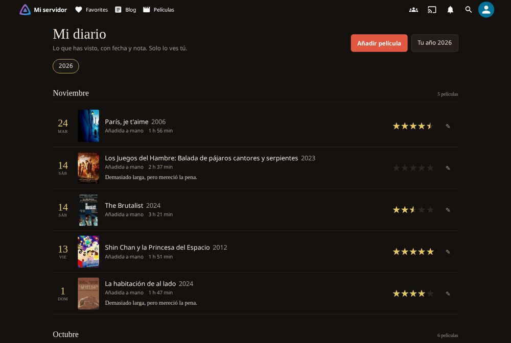

### Tu año de cine

Un resumen del año: cuántas películas, cuántas horas, tu mes y tu día de la semana más cinéfilos, géneros, épocas y lo mejor que puntuaste.

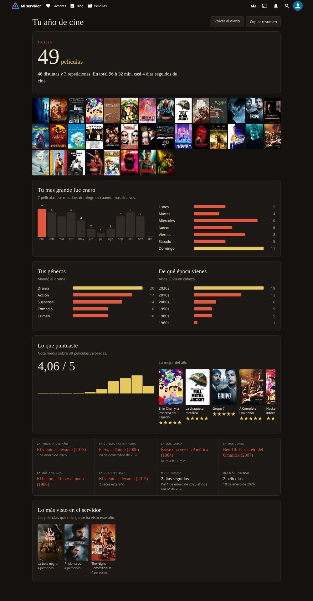

### Mi lista

Lo que quieres ver más adelante. Con filtros, orden y un botón «Sorpréndeme».

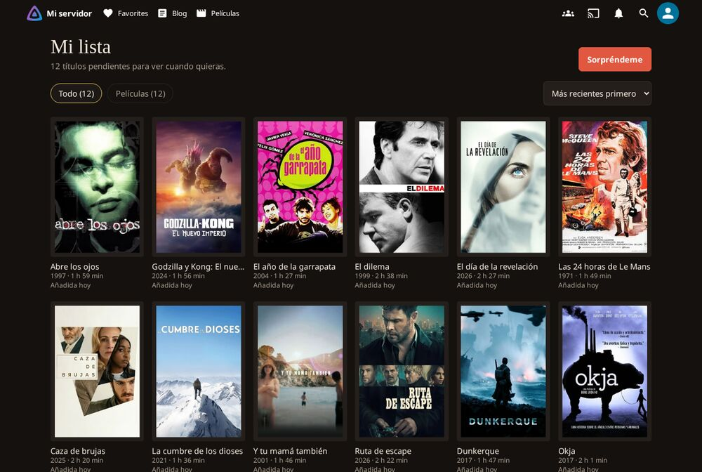

### Blog

Entradas con tus palabras. Si mencionas una película con `@`, sus carátulas salen al final de la entrada, en el orden que tú elijas.

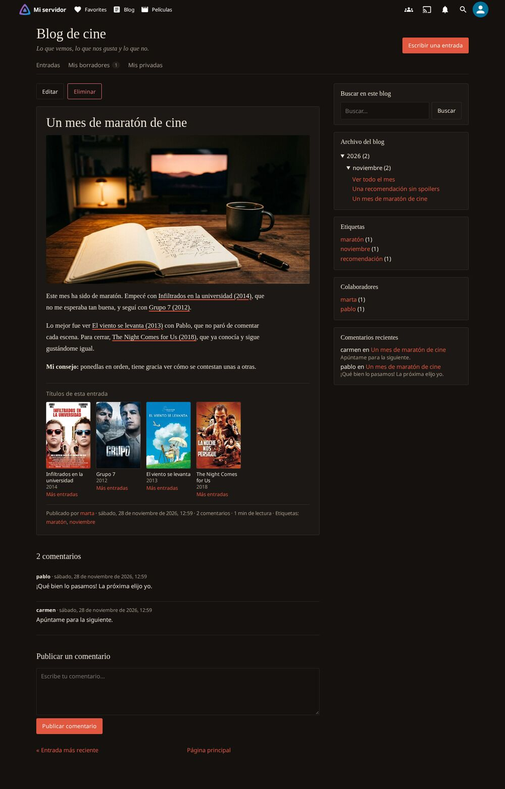

Tienes borradores que solo ves tú y puedes publicar en privado (lo ven el autor y el administrador). Cuando una entrada se hace pública ya no puede volver a ser privada.

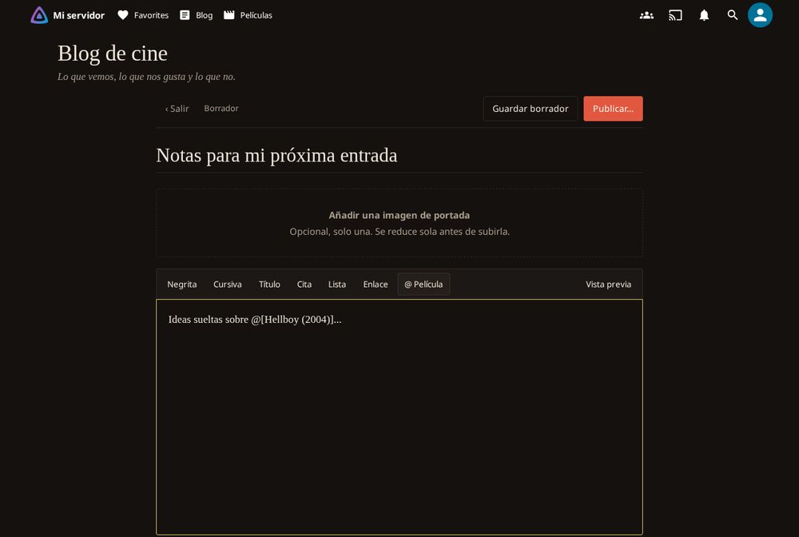

### En el móvil

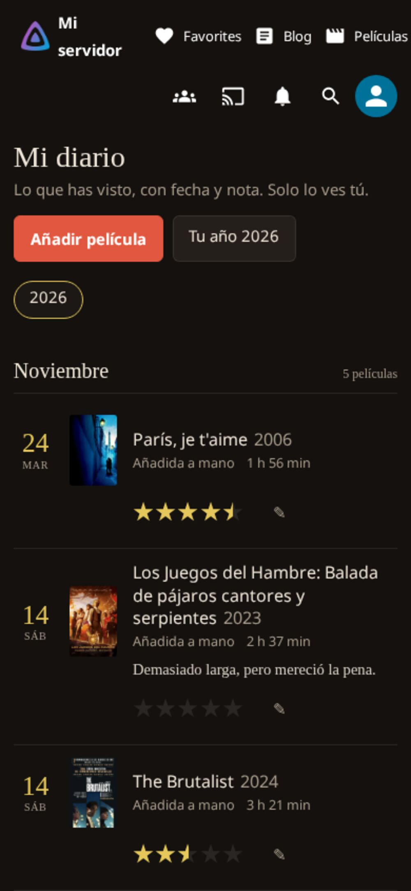

### En el panel de administración

Cada plugin aparece con su imagen en el panel de plugins, y el Blog, el Diario y los avisos tienen su acceso en el menú.

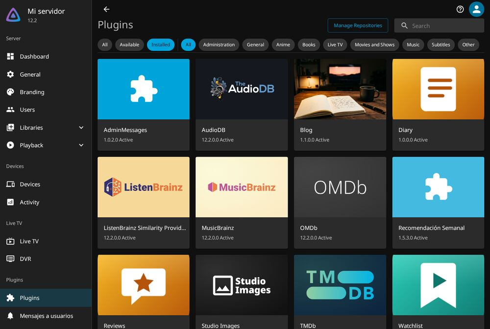

## Cómo instalar

1. En Jellyfin, abre **Panel de control → Complementos → Repositorios** y pulsa **+**.
2. Pon un nombre (el que quieras) y esta dirección:

   ```
   https://github.com/luiscorbachoflores/jellyfin_plugins/raw/main/manifest.json
   ```

3. Ve a **Catálogo**, busca el plugin que quieras (por ejemplo **Diary** o **Blog**) y pulsa **Instalar**.
4. **Reinicia Jellyfin.**
5. Listo. Cada plugin se estrena así:
   - **Diary**: «Mi diario» en el menú de tu usuario (arriba a la derecha), o ve a `#/diary`. Si ya veías películas, pulsa «Traer lo que ya he visto».
   - **Watchlist**: «Mi lista» en el mismo menú. Para añadir algo, usa el menú de tres puntos de cualquier carátula.
   - **Blog**: «Blog» en el menú lateral. Si no lo quieres ahí, se desactiva en los ajustes del plugin.
   - **AdminMessages, Recomendación Semanal, Search Notifier**: se configuran desde su página en el panel de administración.

Cosas que conviene saber:

- Funcionan en el **cliente web** de Jellyfin. Las aplicaciones nativas (móvil, tele) no muestran estas pantallas.
- Casi todos son para **Jellyfin 12.2**. Reviews, JellyAsk, Language Badges y Search Notifier tienen también versión para 10.11.
- Los datos de cada plugin se guardan en la carpeta de plugins de tu servidor, en una base de datos propia. Para quitarlos, desinstala el plugin y borra su carpeta `<Nombre>.Data`.
- Puedes añadir `manifest-staging.json` en vez de `manifest.json` si quieres las versiones nuevas antes.

---

## Detalles técnicos

Lo que sigue es la documentación de cada plugin, para quien quiera saber cómo funcionan por dentro.

Los que llevan interfaz inyectan su propio script en `index.html` mediante un middleware ASP.NET Core en tiempo de respuesta, **sin modificar ningún fichero de jellyfin-web**.

## Reviews

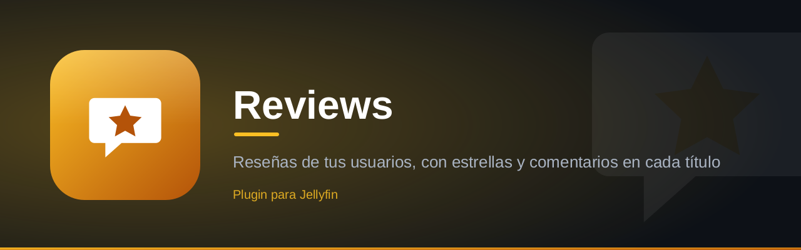

Añade un bloque de reseñas de usuarios a la página de detalle de cada película o serie: valoración por estrellas en pasos de 0,5, comentario de texto y opción de publicar como usuario identificado de Jellyfin o de forma anónima.

- API REST propia (`GET/POST /Reviews/{itemId}`), almacenamiento SQLite.
- El modo "usuario" verifica el token de sesión en el servidor.

Código en [`src/Reviews`](src/Reviews).

## JellyAsk

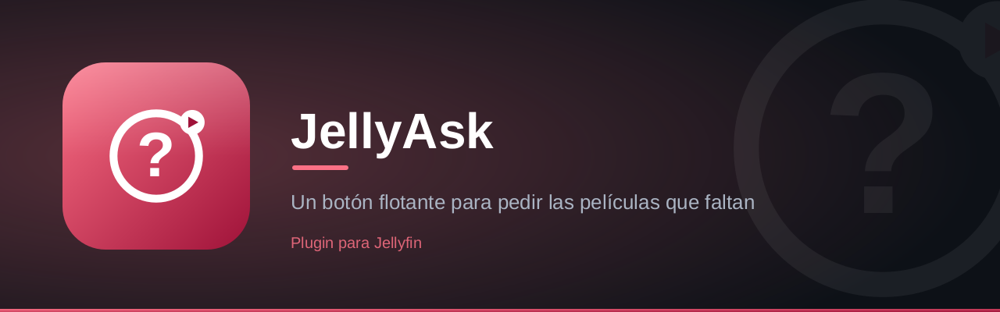

Añade un **botón flotante "Pedir película"** (ya no un enlace en el cajón lateral, que en el cliente web 12.x dejó de ser visible). Abre un formulario con un único campo de texto libre ("Incluye todos los detalles posibles para que podamos encontrar la película"); al enviarlo, registra la petición en el **Activity Log nativo de Jellyfin** (Panel de control → Actividad), visible para cualquier plugin de notificaciones (p. ej. un notificador de Telegram) que escuche esos eventos.

- Requiere sesión Jellyfin válida (no admite modo anónimo).
- API REST propia (`POST /JellyAsk/Request`).
- En Jellyfin 12.x la cabecera `X-Emby-Token` está retirada: el plugin envía `Authorization: MediaBrowser Token="..."` (desde la 1.2.1.0). Cualquier script propio o plugin (p. ej. Reviews) que llame a la API de Jellyfin debe usar esa cabecera en 12.x.

Código en [`src/JellyAsk`](src/JellyAsk).

## Language Badges

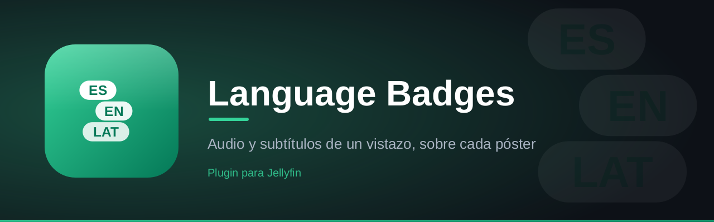

Muestra, de un vistazo, en qué idioma está cada película o serie: chips de **audio** (`ES`, `EN`, `LAT`, `JA`...) sobre el póster en biblioteca, inicio y búsqueda, y una línea **Audio / Subtítulos** en la ficha. Los idiomas que el usuario prefiere se resaltan en amarillo. Lee los `MediaStreams` ya analizados por Jellyfin (incluye versiones alternativas; las series agregan sus episodios).

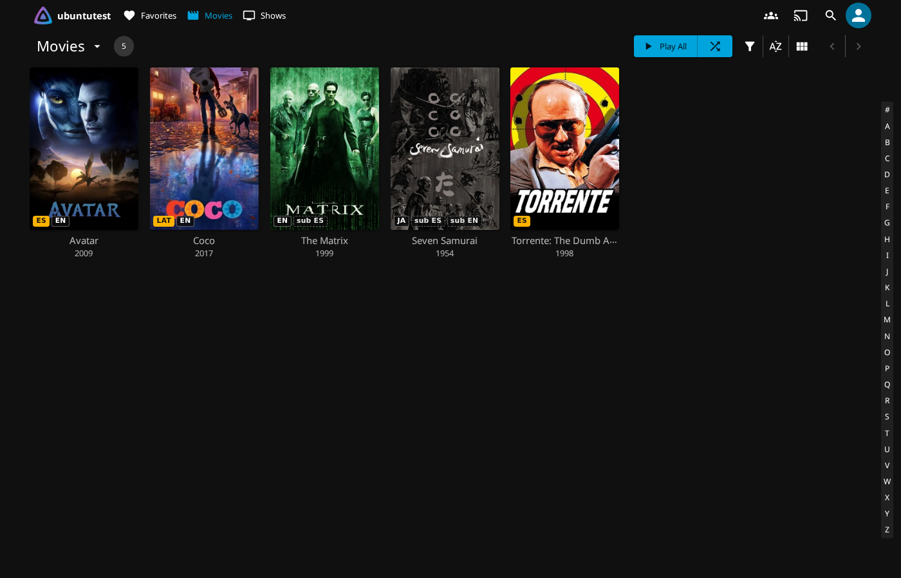
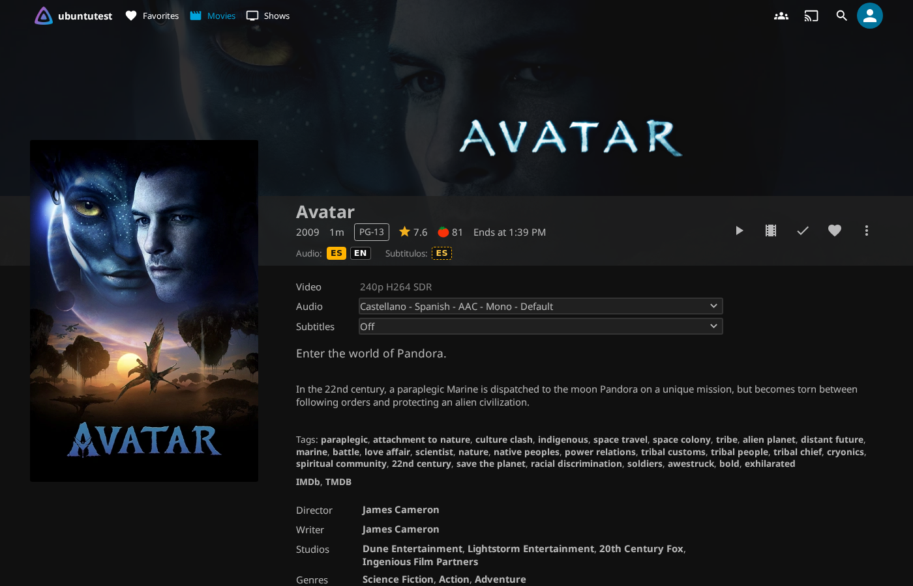

- API: `GET /LanguageBadges/Items?ids=a,b,c` (token de usuario). Script cliente inyectado al servir `index.html` (`/LanguageBadges/client.js`).
- Las insignias solo aparecen en el cliente web de Jellyfin (no en apps nativas).
- Opciones en Panel → Plugins → Language Badges: idiomas destacados, subtítulos, series, máximo de chips.

Código en [`src/LanguageBadges`](src/LanguageBadges).

## Search Notifier

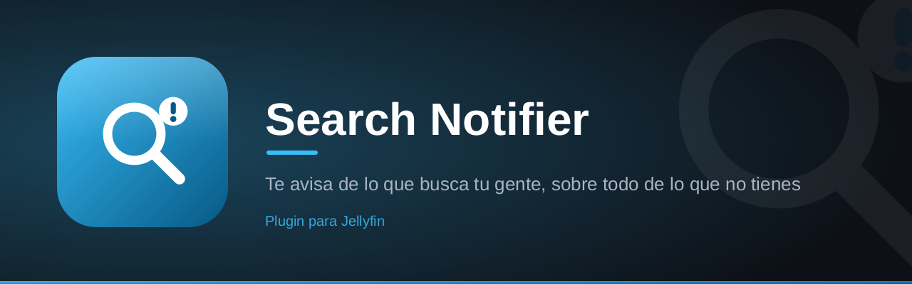

Avisa al admin cuando un usuario busca algo. Detecta cualquier petición con `searchTerm` (web, Android, Swiftfin, Kodi...), agrupa el "buscar mientras escribes" en una sola búsqueda y guarda **solo** usuario, término, nº de resultados y fecha. Cada búsqueda se anota en el **Registro de actividad** del panel de administración (visible ahí y reutilizable por cualquier plugin de notificaciones que lea la actividad, p. ej. hacia Telegram). Opcionalmente envía además un webhook JSON (`text` para Slack/Mattermost, `content` para Discord, o Telegram directo con `chat_id`). La opción "solo sin resultados" avisa de lo que alguien busca y no tienes.

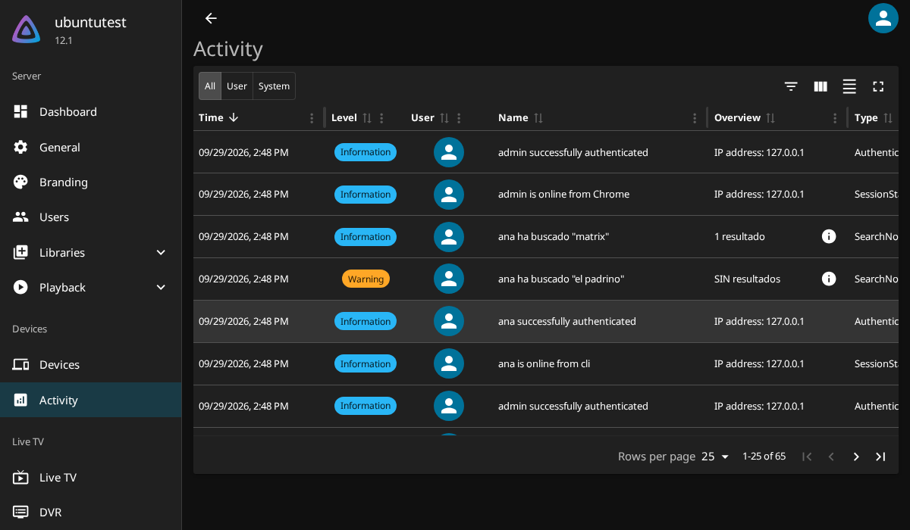
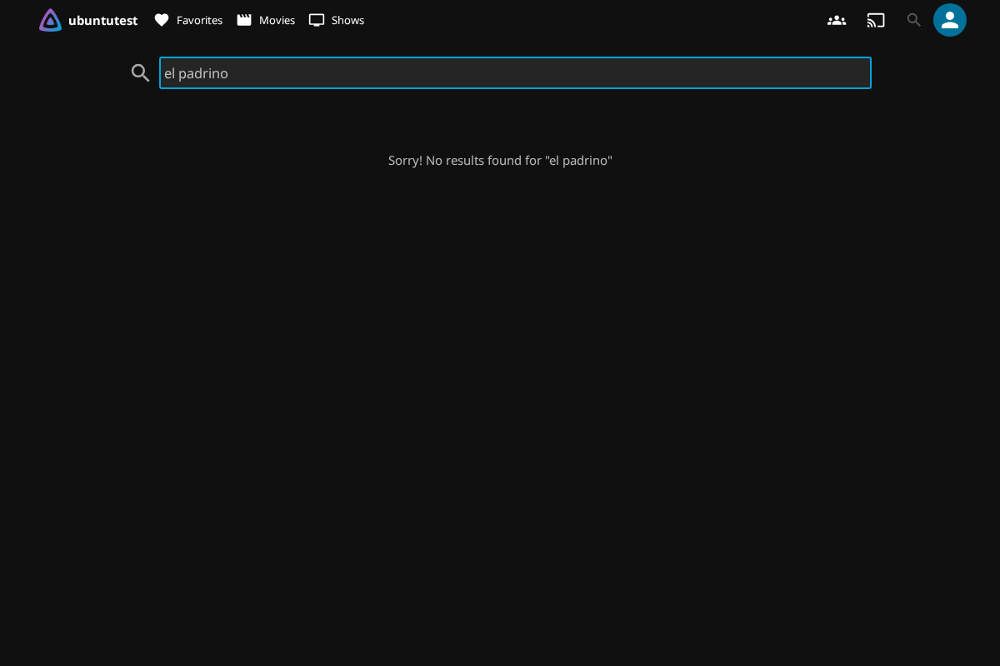
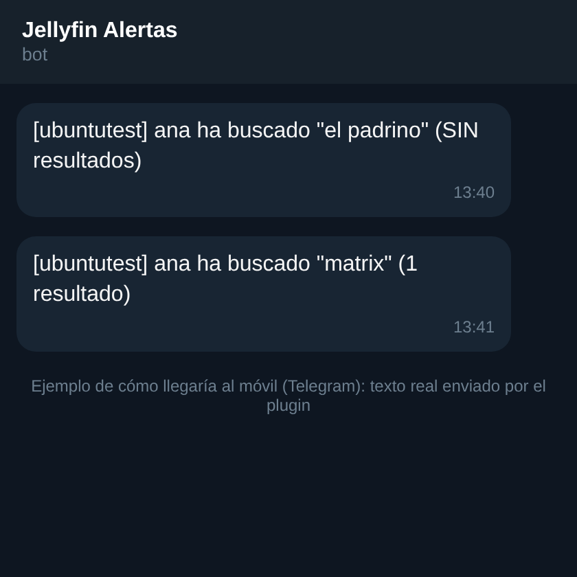
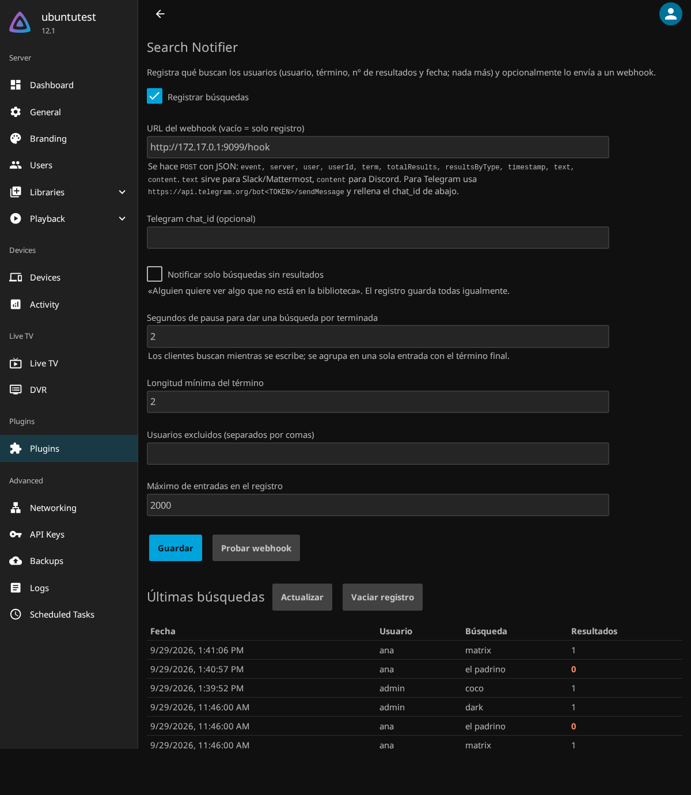

- API admin: `GET/DELETE /SearchNotifier/Log`, `POST /SearchNotifier/TestWebhook`.
- Privacidad: se registran las búsquedas de los usuarios; conviene avisarles.

Código en [`src/SearchNotifier`](src/SearchNotifier).

## Recomendación Semanal (WeeklyPick)

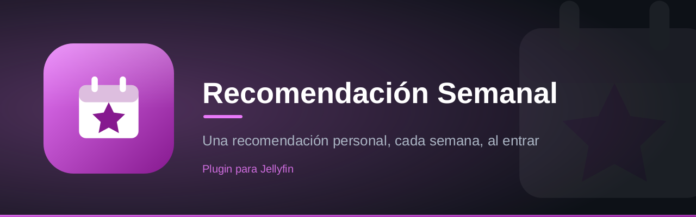

Muestra un aviso emergente, una vez por semana (la semana se reinicia los viernes), con una recomendación personal del dueño de la filmoteca. Se configura desde su página en el panel de plugins.

- Solo para **Jellyfin 12.2** (.NET 10, `Jellyfin.Controller` 12.2.0, targetAbi `12.2.0.0`).
- Instalación: descarga `Jellyfin.Plugin.WeeklyPick.zip` de la [release](https://github.com/luiscorbachoflores/jellyfin_plugins/releases/tag/weeklypick-v1.1.0.0) y descomprímelo en la carpeta `plugins/` de Jellyfin (o añade `manifest-staging.json`, en vez de `manifest.json`, como repositorio), y reinicia Jellyfin.
- El script cliente usa `Authorization: MediaBrowser Token="..."`.

Código en [`src/WeeklyPick`](src/WeeklyPick).

## Blog

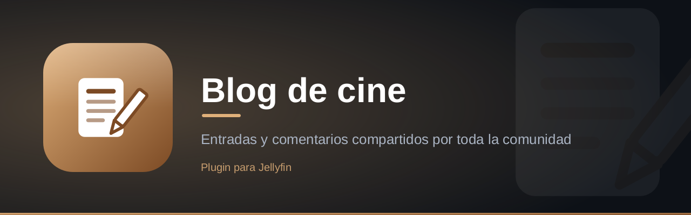

Blog de cine compartido, al estilo de los blogs clasicos de Blogspot: cualquier usuario con sesion lee y publica entradas (texto, etiquetas, marca de spoilers) y comenta. Pantalla propia en #/blog con columna lateral (buscador, archivo por ano y mes, etiquetas, colaboradores y comentarios recientes). El autor edita y borra lo suyo; un admin puede borrar (no editar) contenido ajeno.

Desde la 1.1: cada usuario tiene sus **borradores** (autoguardado, solo los ve el autor), puede publicar **en privado** (solo el autor y el administrador, que las ve en una pestana aparte) y, una vez publicada en publico, la entrada ya no puede volver a privada. Se **mencionan peliculas** escribiendo @ (autocompletado con la biblioteca) y al final de la entrada salen sus caratulas como acceso rapido, en el orden que elige el autor. Una imagen de portada por entrada, reducida en el navegador y guardada como fichero (no en la base de datos). La configuracion trae una lista de usuarios con acceso mas clara y el plugin aparece en el menu del panel.

- Para **Jellyfin 12.2** (.NET 10, Jellyfin.Controller 12.2.0). Store propio en SQLite (<plugins>/Blog.Data/blog.db); las bases anteriores se migran solas.
- La pantalla se pinta dentro de la ruta comodin de jellyfin-web (#fallbackPage), con su cabecera y tema; todo el texto de usuarios se inserta como texto, nunca como HTML.
- Entrada Blog en el menu lateral mediante menuLinks de /web/config.json (un middleware la anade sin tocar los enlaces del admin). Se puede desactivar en la configuracion del plugin (ShowInMenu).
- API (/Blog): Info, Posts (vistas drafts, private, hidden para admin), Posts/{id}, Posts/{id}/Comments, Comments/{id}, Sidebar, Mentions/{itemId}; 401 sin sesion, 404 si la entrada no es visible para quien pregunta, 409 al intentar volver privada una entrada publica.
- Si esta instalado Reviews 1.6 o superior, la ficha de una pelicula muestra «Mencionada en el blog» con las entradas publicas que la citan.
- Diagnostico: localStorage['blog.debug'] = '1'.
- Tests: dotnet test tests/Jellyfin.Plugin.Blog.Tests y node tests/blog-js/e2e.js (Playwright contra una instancia de pruebas real).

Codigo en [`src/Blog`](src/Blog).

## Diary (Diario de cine)

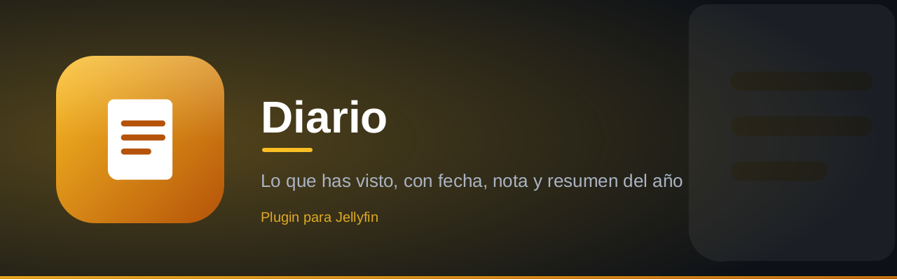

Diario privado de cine por usuario en #/diary, con «Mi diario» en el menu del usuario junto a «Mi lista». Cada pelicula que se termina de ver se apunta sola con su fecha («vista aqui»), igual que las que se marcan como vistas a mano («marcada a mano»); reproducir a medias no cuenta y desmarcar «visto» lo deshace. Cada persona puede cambiar la fecha, puntuar en medias estrellas, escribir un comentario, anadir peliculas que vio fuera y borrar entradas. Un boton trae lo que Jellyfin ya tenia como visto (Jellyfin solo guarda la ultima fecha de cada pelicula, no cada visionado).

**Tu ano de cine** (#/diary/year/AAAA): resumen del ano con peliculas y horas, mosaico de caratulas, mes y dia de la semana grandes, generos, epocas, notas, rachas, primera y ultima pelicula y lo mas visto del servidor (a partir de tres personas).

- Para **Jellyfin 12.2** (.NET 10, Jellyfin.Controller 12.2.0). Store propio en SQLite (<plugins>/Diary.Data/diary.db). Solo usa APIs publicas: el evento IUserDataManager.UserDataSaved y la API HTTP del plugin.
- Privacidad: cada usuario solo ve y modifica su diario (404 si la entrada es de otro). El administrador solo ve cuantas entradas tiene cada usuario en la pagina de configuracion.
- API (/Diary): Entries (GET, POST, PUT y DELETE por id), Year/{ano}, Import, Admin/ImportAll y Admin/Summary; 401 sin sesion.
- Configuracion: horas en las que dos registros de la misma pelicula cuentan como un visionado (12 por defecto) y boton para importar el historial de todos los usuarios.
- Las fechas automaticas usan la zona horaria del servidor.
- Tests: dotnet test tests/Jellyfin.Plugin.Diary.Tests y node tests/blog-js/diary-e2e.js.

Codigo en [`src/Diary`](src/Diary).

## AdminMessages

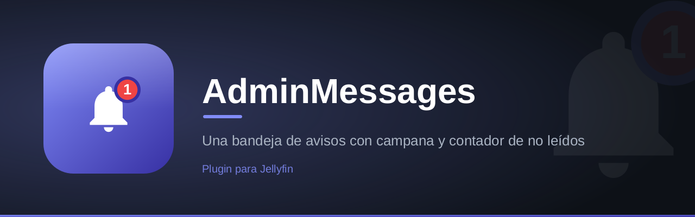

Bandeja de avisos persistentes del administrador: desde una pagina del panel ("Mensajes") se crean/editan/borran mensajes (titulo + cuerpo + link opcional) dirigidos a todos los usuarios o a una lista concreta. Cada usuario los ve en un desplegable anclado a un icono de campana en la barra superior, con contador de no leidos, boton "Abrir enlace" si el mensaje lleva uno, y puede marcarlos como leidos. Sin caducidad automatica, unidireccional (el usuario no responde) y sin aviso en vivo por WebSocket en esta v1 — ver [docs/SPECS.md](docs/SPECS.md) (seccion 0002) para el detalle y los defaults asumidos.

El campo Link (spec 0003) absorbe el caso de uso "Announcements" (avisar de que el recap anual esta listo en una URL externa): en vez de un plugin aparte, es un mensaje broadcast con Link a esa URL.

- Para **Jellyfin 12.2** (.NET 10, Jellyfin.Controller/Jellyfin.Model 12.2.0, targetAbi 12.2.0.0) — confirmado en vivo contra un Jellyfin 12.2 real.
- API: POST/GET /AdminMessages y PUT/DELETE /AdminMessages/{id} (admin); GET /AdminMessages/mine y POST /AdminMessages/{id}/read (usuario autenticado). Persistencia SQLite propia.
- El script cliente usa Authorization: MediaBrowser Token="...".
- Validado en vivo (POC): instalacion, permisos 401/403, inyeccion del icono en la barra superior en layout moderno (no se pudo probar legacy/TV).

Codigo en [`src/AdminMessages`](src/AdminMessages).

## Watchlist (Mi lista)


Lista personal "para ver" por usuario (distinta de Favoritos). Se anade/quita desde el menu de tres puntos de cualquier caratula o ficha (icono more_vert, cubre rejilla y detalle con el mismo selector), y "Mi lista" en el menu del usuario (junto a Perfil/Ajustes) abre la lista, que desde la 1.1 es una pantalla propia (#/watchlist) y no una ventana emergente. Solo cliente web.

- Para **Jellyfin 12.2** (.NET 10, Jellyfin.Controller 12.2.0). Store propio en SQLite (<plugins>/Watchlist.Data/watchlist.db), maximo 500 titulos por usuario; cada usuario solo ve y modifica la suya (ni un admin ve la de otros).
- API: GET /Watchlist, GET|POST|DELETE /Watchlist/Items/{itemId}; 401 sin sesion, 404 si el usuario no puede ver el item, 400 si no es pelicula/serie o se supera el limite.
- La pantalla #/watchlist muestra las caratulas en rejilla con ano, duracion y cuanto hace que se anadieron, filtro por peliculas y series, cuatro ordenes y un boton «Sorprendeme» que abre un titulo al azar de la lista.
- **Acceso de emergencia:** si una version futura de jellyfin-web rompe los anclajes de menu, abre #/home?watchlist=open (parametro watchlist=open en el hash) y se abre la pantalla de la lista.
- Diagnostico: localStorage['watchlist.debug'] = '1' muestra en consola que estrategia de anclaje encajo ([Watchlist] menu: modern-app-user-menu).
- Tests: node tests/blog-js/diary-e2e.js tambien recorre esta pantalla contra una instancia de pruebas real.

Codigo en [`src/Watchlist`](src/Watchlist).

## Desarrollo

Cada plugin es un proyecto .NET independiente:

```
cd src/Reviews   # o src/JellyAsk
dotnet build -c Release -o build
```

Para Language Badges y Search Notifier hay un script que genera los zips e `meta.json`: `scripts/build-new-plugins.sh [versionJellyfin] [dirPlugins]` (por defecto 10.11.8; p. ej. `12.1.0` para Jellyfin 12, con `targetAbi` acorde). Tests en [`tests/`](tests) (`setup_and_test.py`, `webhook_test.py`, `ui_screenshots.py`, `search_demo.py`).

El resultado en `build/` incluye el DLL del plugin y sus dependencias. Para desplegar manualmente, copia el contenido a `config/plugins/<Nombre>_<version>/` de tu instancia de Jellyfin.

Para empaquetar una tanda para Jellyfin 12.2 (zips en dist/ y entradas nuevas en manifest.json y manifest-staging.json) esta `scripts/release.py`: `python3 scripts/release.py Blog Diary Watchlist`. No sube nada; las releases de GitHub se crean despues con los zips.

Para comprobar pronto si una version nueva de Jellyfin rompe un plugin, compila contra ella: `dotnet build src/Diary -c Release -p:JellyfinVersion=12.4.0` (los plugins para 12.x aceptan ese parametro). Compilan contra 12.3.0 y 12.4.0.

## Compatibilidad

Reviews y JellyAsk: probados contra Jellyfin **10.11.11**. Language Badges y Search Notifier: probados en **10.11.8** y **12.1.0** (API y navegador headless). El anclaje visual usa clases del cliente web oficial (`.itemDetailPage`, `.overview-controls`, `.mainDrawer-scrollContainer`, `.btnSettings`); si una versión futura de Jellyfin cambia esa estructura, solo haría falta actualizar el JS correspondiente (`src/Reviews/wwwroot/reviews.js` o `src/JellyAsk/wwwroot/jellyask.js`), no el resto del plugin.
